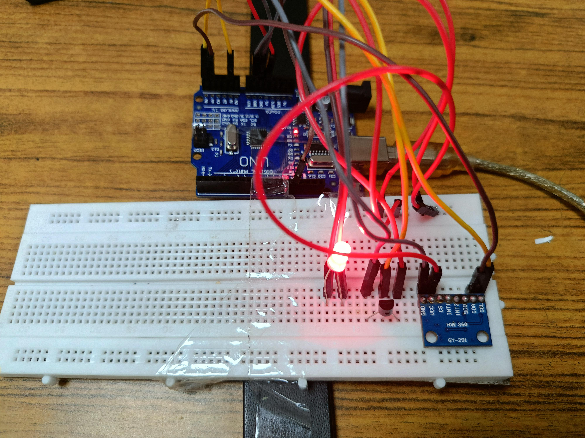

<div align="center">
  
  
  # ElderCare: AI-Driven Fall Detection & Health Monitoring
</div>

[](https://www.python.org/)
[](https://opencv.org/)
[](https://opensource.org/licenses/MIT)

ElderCare is an intelligent monitoring system designed to enhance the safety and well-being of elderly individuals through real-time fall detection and health monitoring.

## 🚀 Key Features

- **Real-time Fall Detection**
  - Utilizes OpenCV and MediaPipe for accurate posture analysis
  - Instant alerts for detected falls
  - Continuous monitoring of movement patterns

- **Wearable Health Monitoring**
  - Arduino-based prototype for vital signs tracking
  - Heart rate and pulse monitoring
  - Body temperature sensing

- **Emergency Alert System**
  - Immediate notifications to caregivers
  - Quick response protocol activation

## 🛠️ Tech Stack

- **Backend**: Python 3.8+
- **Computer Vision**: OpenCV, MediaPipe
- **Hardware**: Arduino
- **Data Handling**: JSON

## ⚙️ Installation

1. Clone the repository:
   ```bash
   git clone https://github.com/yourusername/ElderCare.git
   cd ElderCare
   ```

2. Install dependencies:
   ```bash
   pip install -r requirements.txt
   ```

3. Connect your Arduino device and update the configuration in `config.json`.

## 🚀 Quick Start

1. Start the monitoring system:
   ```bash
   python main.py
   ```

2. For fall detection:
   ```bash
   python fall_detection.py
   ```

## 📱 Demo

To see the system in action:

1. Ensure your camera is connected
2. Run the fall detection script
3. The system will display real-time analysis

## 📈 Future Scope

- Integration with mobile applications for remote monitoring
- Advanced health analytics and predictive modeling
- Expanded sensor support for comprehensive health tracking

## 🤝 Contributing

Contributions are welcome! Please read our [contributing guidelines](CONTRIBUTING.md) before submitting pull requests.

## 📄 License

This project is licensed under the MIT License - see the [LICENSE](LICENSE) file for details.

## 🙏 Acknowledgments

- MediaPipe for the pose estimation models
- OpenCV community for computer vision tools
- Arduino for the hardware platform